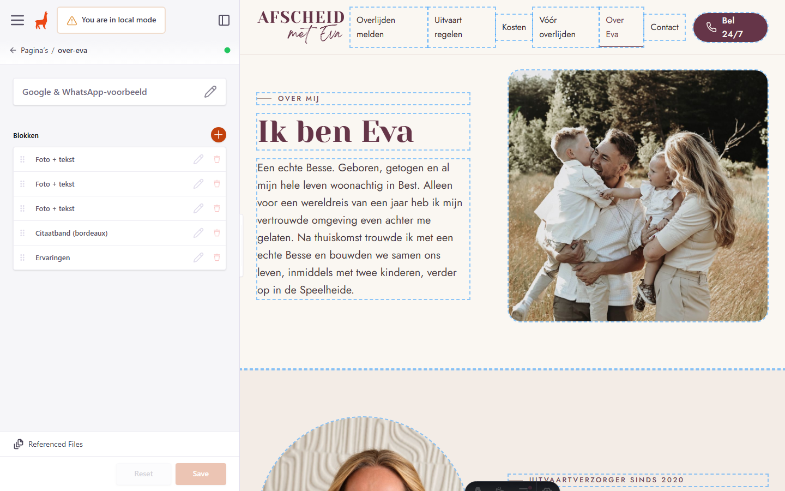
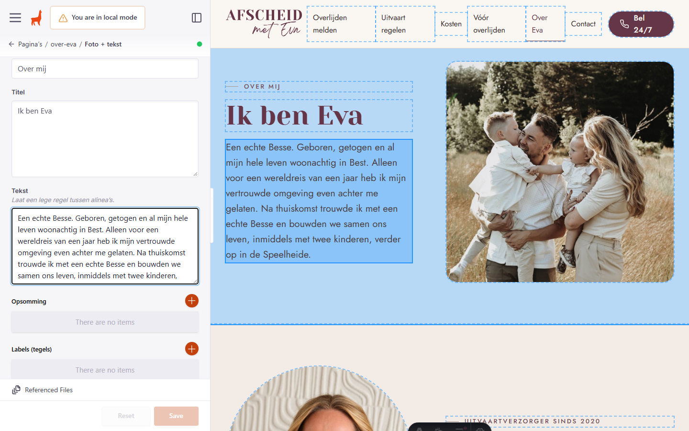
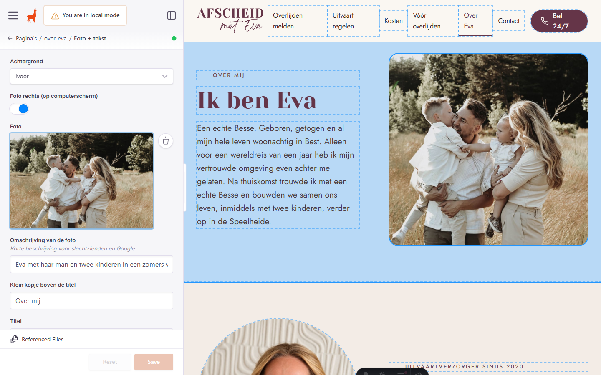

# Handleiding: je website zelf aanpassen

Hoi Eva! Met deze handleiding pas je zelf teksten en foto's op je website aan. Je kunt niets kapotmaken: kleuren, lettertypes en de opmaak liggen vast. Alleen de inhoud kun je veranderen.

> Het beheerscherm is in het Engels. De belangrijkste knoppen: **Save** = opslaan, **Reset** = wijzigingen ongedaan maken.

---

## 1. Inloggen

1. Ga naar **jouwdomein.nl/admin** (Tommy geeft je het precieze adres).
2. Klik op **Log in** en log in met je e-mailadres en wachtwoord van TinaCloud.
3. Je ziet nu links het bewerkpaneel en rechts je website.

**Naar een andere pagina?** Klik rechts gewoon op een menu-item, of klik links bovenaan op **Pagina's** en kies een pagina.

---

## 2. Een tekst aanpassen

1. Klik rechts **op de tekst** die je wilt veranderen.
2. Links springt het bijbehorende vakje open.
3. Typ je nieuwe tekst. Rechts zie je meteen hoe het eruitziet.

**Tips**
- Een **nieuwe alinea**: laat een lege regel staan (twee keer Enter).
- Teksten tussen **[haakjes]** zijn nog niet ingevuld. Vervang ze door je eigen tekst.
- Je telefoonnummer, WhatsApp, e-mail, KvK en het menu staan op één plek: **Instellingen** (menu linksboven ☰). Pas je daar iets aan, dan verandert het overal op de site.

---

## 3. Een foto wisselen

1. Klik rechts **op de foto**.
2. Links zie je de foto. Klik erop om een andere te kiezen, of sleep een nieuwe foto in het venster om hem te uploaden.
3. Vul bij **Omschrijving van de foto** kort in wat erop staat (bijvoorbeeld "Eva met een kop thee"). Dat helpt slechtzienden en Google.

**Tip:** gebruik liefst foto's van maximaal 2000 pixels breed (een foto van je telefoon is prima). De website maakt ze zelf kleiner en sneller.

---

## 4. Een blok toevoegen, verplaatsen of verwijderen

Elke pagina bestaat uit **blokken** (bijvoorbeeld "Foto + tekst", "Citaatband", "Veelgestelde vragen").

- **Toevoegen:** klik op het oranje **+** naast "Blokken" en kies een bloktype. Het nieuwe blok komt onderaan; vul daarna de teksten in.
- **Verplaatsen:** pak het blok bij de **zes puntjes** (⠿) links en sleep het omhoog of omlaag.
- **Aanpassen:** klik op het **potloodje**.
- **Verwijderen:** klik op het **prullenbakje**.

---

## 5. Opslaan en publiceren

1. Klik linksonder op **Save**.
2. Je wijziging staat na **1 à 2 minuten** live op je website.
3. Wil je je wijzigingen toch niet bewaren? Klik dan vóór het opslaan op **Reset**.

---

## 6. Een eerdere versie terugzetten

Elke keer dat je opslaat, wordt er automatisch een versie bewaard. Iets per ongeluk weggehaald of veranderd?

- **Kleine dingen:** typ de oude tekst gewoon opnieuw en sla op.
- **Grotere vergissingen:** stuur Tommy een berichtje met welke pagina en ongeveer hoe laat. Hij kan elke eerdere versie terugzetten, ook van weken geleden.

---

## Hulp nodig?

Bel of app Tommy. Je kunt echt niets kapotmaken: alles wat je opslaat, kan altijd worden teruggezet.
